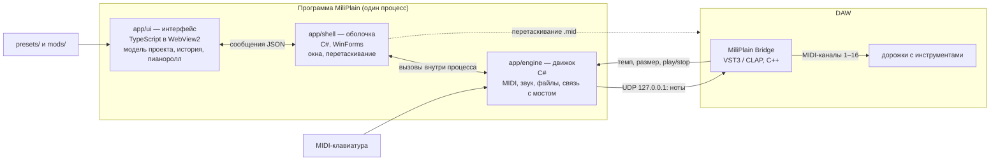
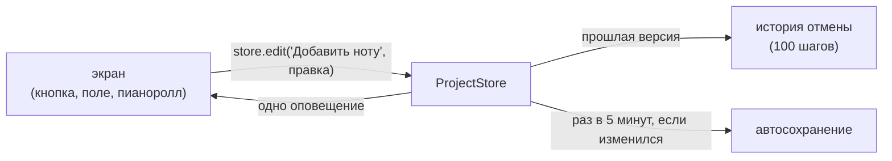
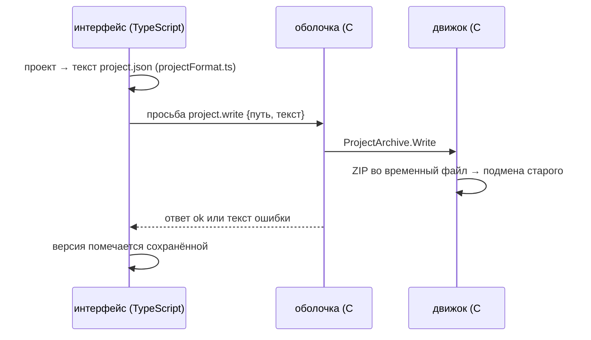
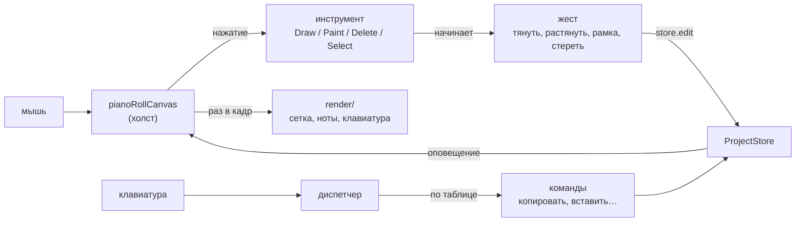

# Как устроена MiliPlain

> Обновлено на этапе 1. Уточняется на каждом следующем этапе. Почему
> устроено именно так — в [DECISIONS.md](DECISIONS.md). Что лежит в каждой
> папке — в [map/](map/root.md).

## Схема

## Части и их обязанности

| Часть | Язык | Отвечает за | Не отвечает за |
| --- | --- | --- | --- |
| `app/ui` | TypeScript | всё видимое; модель проекта и история отмены; горячие клавиши; пресеты и моды | доступ к файлам, MIDI-устройствам и звуку |
| `app/shell` | C# | окна Windows с WebView2; перетаскивание файлов; передача сообщений между `ui` и `engine` | логику проекта |
| `app/engine` | C# | MIDI-вход и выход; таймер проигрывания; встроенный звук; связь с мостом; файлы, автосохранение, логи | окна и всё, что зависит от Windows |
| `bridge` | C++ | приём нот от программы и выдача их в DAW; передача темпа и транспорта DAW | всё остальное |

`engine` — обычная библиотека .NET без привязки к Windows. `shell` загружает её
в свой процесс. Чтобы перенести MiliPlain на другую систему, нужна новая
оболочка, а `ui` и `engine` остаются как есть.

## Проект и история отмены

Проект живёт в интерфейсе, в хранилище `ProjectStore` (`app/ui/src/state`).
Объекты модели неизменяемые: правка создаёт новую версию проекта, а старая
уходит в историю. Отмена — это возврат к прошлой версии.

## Как проект попадает на диск

Открытие идёт обратно. Движок достаёт текст из архива, а интерфейс
поднимает старую версию формата (миграции) и проверяет каждое поле.
Только потом проект заменяет текущий.

## Пианоролл

Пианоролл (`app/ui/src/pianoRoll`) — холст Canvas 2D и логика, которая про
холст не знает.

Окно просмотра (`viewport.ts`) переводит пиксели в тики и высоты нот. Через
него инструменты понимают, куда нажали, — поэтому их логика проверяется
тестами без экрана. Пианоролл показывает ноты выбранного канала в открытом
паттерне.

## Как нота попадает в DAW

1. **Мышью (метод LARD).** Интерфейс меняет модель проекта. Если нужно
   прослушать ноту, он просит движок сыграть её, движок отправляет её мосту,
   мост — в DAW.
2. **С MIDI-клавиатуры.** Движок получает ноту в потоке драйвера и сразу
   пересылает мосту, не заходя в интерфейс: интерфейс может быть занят
   перерисовкой, а задержка должна оставаться меньше 10 мс. Параллельно нота
   уходит в интерфейс — для записи в паттерн.
3. **Проигрывание паттерна.** Интерфейс отдаёт движку снимок паттерна. Движок
   играет его по своему таймеру: через мост (звучит инструмент DAW) или через
   встроенный синтезатор.

## Как паттерн перетаскивается в DAW или в папку

Интерфейс берёт ноты из **актуального** состояния модели и отдаёт их оболочке.
Оболочка записывает `.mid` в `%TEMP%\MiliPlain\drag\`, кладя в файл темп
и размер, и запускает системное перетаскивание файла. Временные файлы
удаляются при выходе из программы и при запуске, если им больше суток.

## Что ещё не решено

- Библиотека для интерфейса (или её отсутствие) — этапы 2–3.
- Окончательный протокол связи с мостом — этап 5.
- Отстыкованные панели (этап 7): каждая — отдельное окно со своим WebView2,
  все окна делят одну среду WebView2, чтобы не умножать память.
